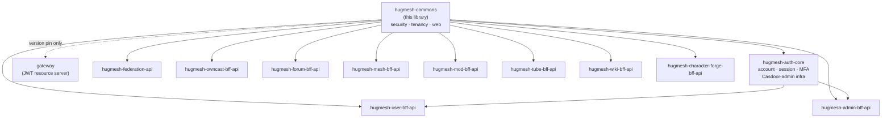

# hugmesh-commons

The shared, **canonical** HugMesh security / tenancy / config / web building
blocks. The classes in this library were previously duplicated — with only package names
and access modifiers changed — into every reactive BFF (`hugmesh-federation-api`,
`hugmesh-admin-bff-api`, `hugmesh-user-bff-api`, `hugmesh-owncast-bff-api`,
…) and the gateway. This library is the single source of truth for the reactive
BFFs, which take it as a compile dependency. Some keep a thin local `Roles` or
`PrincipalDomain` helper next to it (`hugmesh-mesh-bff-api`'s `Roles` delegates to
this library; `hugmesh-forum-bff-api`'s `Roles` is a copy taken from the gateway).
The gateway is the one exception — it deliberately keeps its own vendored copies;
see below.

It sits at the bottom of the shared-artifact stack. `hugmesh-auth-core` — the
shared account / session / MFA / Casdoor-admin infrastructure consumed by
`hugmesh-user-bff-api` and `hugmesh-admin-bff-api` — depends on **this** library
for its security and tenancy primitives. Every reactive BFF also depends on it
directly for the security / tenancy / web classes described below. The gateway
takes a direct, explicitly-versioned dependency on commons too, but only to pin
the Boot-4 / Security-7 binary-compat milestone: it deliberately keeps its own
vendored `Roles` / `DomainRegistry` / `CasdoorAuthorities` /
`TenancyResourceServerConfig`, because a class-by-class diff found the gateway's
copies are supersets carrying methods this library lacks and the gateway depends on
(see the native-login sequence diagram under [Current State](#current-state)).



## Coordinates

```
groupId:    net.hugmesh
artifactId: hugmesh-commons
version:    2.1.0
packaging:  jar
```

Child of `net.hugmesh:hugmesh-parent:2.8.0` (the metapom), which pins the
ecosystem baseline: **Spring Boot 4.0.7 / Spring Cloud 2025.1.2** on **Java 25 LTS**
(eclipse-temurin:25), with Testcontainers 2.0.5.

## Contents

| Class | Package | Role |
|-------|---------|------|
| `Roles` | `net.hugmesh.commons.security` | JWT role / domain / MFA-stamp extraction. |
| `RoleName` | `net.hugmesh.commons.security` | closed enum of the four base Casdoor role tokens (`user`/`mod`/`admin`/`superadmin`); fail-closed `fromWire`/`require`/`isBaseRole` with the lowercase on-the-wire value preserved as a live contract. |
| `CasdoorAuthorities` | `net.hugmesh.commons.security` | Casdoor JWT → Spring authorities converter (the RESERVED-PREFIX injection guard lives here). |
| `DomainRegistry` | `net.hugmesh.commons.security` | issuer-URI → brand/domain map; single-issuer back-compat + multi-brand fail-closed; `knownDomains`/`isKnownDomain` validation. |
| `PrincipalDomain` | `net.hugmesh.commons.security` | instance-based, SUPERADMIN-aware per-request tenant scope (was the federation/admin `DomainScope`). |
| `DomainScope` | `net.hugmesh.commons.tenancy` | static SQL-predicate utility (`andPredicate`/`isUnscoped`) for per-domain repositories (was the user/owncast `DomainScope`). |
| `TenancyResourceServerConfig` | `net.hugmesh.commons.config` | config-gated, backward-compatible multi-issuer (per-brand Casdoor) resource-server wiring. |
| `ApiException` | `net.hugmesh.commons.web` | the BFF `{"error": msg}` exception with the full union of HTTP-status factories. |

## Preserved security behaviours

1. JWT `roles` claim → `ROLE_` authorities, via `Roles.fromJwt` and `CasdoorAuthorities`.
2. An `isAdmin` claim that is the boolean `true` (the Casdoor legacy form) → `ROLE_ADMIN`.
   A string such as `"true"` does not count.
3. `DOMAIN_<x>` authority is derived **only** from the cryptographically-validated JWT
   issuer URI — never from user-supplied claim values.
4. **RESERVED_PREFIXES guard** — any entry of the `permissions` claim beginning with
   `ROLE_`, `DOMAIN_`, or `MFA_SATISFIED` (matched case-insensitively, after trimming)
   is silently dropped, preventing authority injection, cross-tenant escalation, and
   MFA forgery.
5. **Fail-closed domain resolution** — when `app.tenancy.issuers` is set, an issuer
   not in the map resolves to `null` (not a default domain), and the multi-issuer
   decoder rejects that token with `401` before any authorities are built. With no
   issuer configured at all, `DomainRegistry.domainOf` returns `"default"` for
   everything. `domainOf(authorities)` also returns `null` when zero or more than
   one `DOMAIN_` authority is present, because multiple domain authorities are a sign of
   token manipulation.
6. SUPERADMIN principals are exempt from per-domain scoping. This is enforced uniformly
   via `Roles.isSuperadmin` and `PrincipalDomain`.
7. `MFA_SATISFIED` is derived only from a fresh `mfa_satisfied_at` stamp written by the
   BFF after a successful MFA challenge. The stamp is epoch milliseconds. Stamps set
   in the future, older than the acceptable window, or malformed are rejected. The
   authority is derived only when `app.mfa.enabled` is `true` (default `false`);
   `app.mfa.freshness-window` defaults to `600000` (ten minutes) in
   `TenancyResourceServerConfig`.
8. Multi-issuer support (for per-brand Casdoor deployments) is opt-in and
   backward-compatible. `TenancyResourceServerConfig` loads only when the
   `app.tenancy.issuers` property contains `=` (`@ConditionalOnExpression`);
   `DomainRegistry.isMultiIssuer()` is true when it maps more than one issuer.

All eight are covered by the unit tests under `src/test/java`.

## What stays per-repo

`SecurityConfig` stays in each service: its `authorizeExchange` route matchers
(`/bff/admin/**`, `/bff/user/**`, `/bff/owncast/**`, `/api/federation/**`) and CSRF /
cookie handling differ between services and cannot be centralised. Each repo's
`SecurityConfig` wires the shared `CasdoorAuthorities` / `DomainRegistry` and,
optionally, `TenancyResourceServerConfig`, then declares its own route authorisation
rules. The per-repo security-slice test scaffold (`SecuritySliceSupport`) also stays
per-repo because it must construct the per-repo `SecurityConfig`.

## Using it

```xml
<dependency>
  <groupId>net.hugmesh</groupId>
  <artifactId>hugmesh-commons</artifactId>
  <!-- version managed by hugmesh-parent -->
</dependency>
```

Then delete the repo-local copies of the classes above and update the import
statements. The package root changes from the repo-specific prefix to
`net.hugmesh.commons.*`:

```
# Before (example from federation-api)
import net.hugmesh.federation.security.Roles;
import net.hugmesh.federation.security.DomainRegistry;

# After
import net.hugmesh.commons.security.Roles;
import net.hugmesh.commons.security.DomainRegistry;
```

**Method rename:** Two overloads of `Roles` that accepted `Set<String>` (raw authority
name strings rather than `GrantedAuthority` objects) were renamed to avoid an ambiguity
that the Java compiler cannot resolve at the call site when generics are erased:

| Old name (federation form) | New name |
|---|---|
| `Roles.isSuperadmin(Set<String>)` | `Roles.isSuperadminNames(Collection<String>)` |
| `Roles.domainOf(Set<String>)` | `Roles.domainOfNames(Collection<String>)` |

Calls that pass a `Collection<GrantedAuthority>` use the existing overloads unchanged.

## Shared test base (published test-jar)

Alongside the main jar, the `maven-jar-plugin` `test-jar` goal publishes
`net.hugmesh.commons.testsupport.PostgresTestSupport`
(`src/test/java/net/hugmesh/commons/testsupport/PostgresTestSupport.java`) as
`net.hugmesh:hugmesh-commons:2.1.0:tests` (test scope). Consumers extend it
to get ONE shared Testcontainers-Postgres base for the whole org instead of
re-copying the container/Liquibase/R2DBC wiring per repo:

```xml
<dependency>
  <groupId>net.hugmesh</groupId>
  <artifactId>hugmesh-commons</artifactId>
  <classifier>tests</classifier>
  <version>2.1.0</version>
  <scope>test</scope>
</dependency>
```

The version is explicit because `hugmesh-parent` manages only the main jar, not the
`tests` classifier. Maven would reject the dependency without it.

```java
class MySliceTest extends PostgresTestSupport { /* ... */ }
```

Key properties: a single static Postgres container reused across the whole test JVM
(started once, not per-class), a fresh `cmtest_<n>` database created per test class so
Liquibase seeds never leak across classes, and an overridable `jsonTypeOverride()`
(defaults to `"text"`) for repos whose changelogs reference `${json.type}` against a
real `jsonb` column.

## Build / publish

| Goal | Command |
|---|---|
| Compile and run unit tests | `./mvnw verify` |
| Install to local Maven cache (`~/.m2`) for offline sibling-repo use | `./mvnw install` |
| Publish to GitLab Maven Package Registry (CI only) | `./mvnw deploy -s settings.xml` |

`./mvnw verify` also builds the **test-jar** described in [Shared test base
(published test-jar)](#shared-test-base-published-test-jar) above, alongside the main
jar. `install` and `deploy` carry it on to the local cache and the registry.

Two pipelines are checked in:

- `.gitlab-ci.yml` runs `verify` as `build:test`, then, on the default branch and on
  version tags, runs `deploy -DskipTests` to the GitLab Maven Package Registry. The
  deploy step authenticates using the GitLab-injected `CI_JOB_TOKEN` — no secret is
  committed to the repository.
- `.github/workflows/release.yml` publishes the jar and the `tests` classifier to
  GitHub Packages. It runs only on manual dispatch (`workflow_dispatch`), never on
  push or tag. `RELEASING.md` says it has never run; the org's Actions jobs were not
  starting because of billing.

## Current State

- **At `2.1.0` on the unified ecosystem baseline** — Spring Boot 4.0.7 / Spring Cloud
  2025.1.2 on Java 25 LTS, Testcontainers 2.0.5, child of `hugmesh-parent:2.8.0`.
  The groupId is `net.hugmesh`,
  the reverse of `hugmesh.net`, for this artifact and its parent alike. The artifact's
  own `2.1.0` and the inherited `hugmesh-parent:2.8.0` are two different version
  numbers that are not expected to track each other — see
  [Coordinates](#coordinates) and `pom.xml`.
- **Bottom of the shared-artifact stack.** `hugmesh-auth-core` (the shared
  account / session / MFA / Casdoor-admin infrastructure) depends on this library;
  `hugmesh-auth-core` is in turn consumed by `hugmesh-user-bff-api` and
  `hugmesh-admin-bff-api`. Every reactive BFF depends on commons directly for the
  security / tenancy / config / web primitives above. The gateway takes a direct,
  explicitly-versioned dependency on commons too, but only to pin the Boot-4 /
  Security-7 binary-compat milestone — it deliberately keeps its own vendored
  `Roles` / `DomainRegistry` / `CasdoorAuthorities` / `TenancyResourceServerConfig`,
  since a class-by-class diff found the gateway's copies are supersets carrying
  methods this library lacks and the gateway depends on (e.g. `isGameMaster`, `usernameOf`,
  `namesOf`, `domainForHost`). The commons dependency makes the shared types
  available to the gateway for future use, not current use.
- **Auth-model alignment.** The current native-login design keeps the Casdoor JWT
  entirely server-side and Casdoor internal-only — it never redirects the browser.
  `login-ui` renders a first-party login form that POSTs credentials straight to
  `/bff/login` (via the gateway); `user-bff` runs the entire OIDC/PKCE handshake with
  Casdoor itself (generating the PKCE verifier/challenge and state, hitting Casdoor's
  internal `/api/login`, and exchanging the code for a JWT). The account and session
  rows stay in the admin-bff database; `user-bff` writes them through admin-bff's
  internal `/bff/internal` API. The browser never sees a Casdoor URL, authorization code,
  or JWT — it receives only an opaque `bff_`-prefixed session cookie. At the gateway, a
  pre-security exchange filter swaps the `bff_` value for the server-held Casdoor JWT
  by calling admin-bff (`POST /bff/internal/session/exchange`), so
  JWT validation, role extraction, and domain resolution — implemented in the
  gateway's own vendored `Roles` / `DomainRegistry` / `CasdoorAuthorities` (see
  above) — run without modification. The services default these paths off
  (`app.bff.oidc.enabled`, `hugmesh.gateway.bff-exchange.enabled`); the
  `hugmesh-generator` cluster manifests turn them on.

  ```mermaid
  sequenceDiagram
      participant Browser
      participant login-ui
      participant gateway
      participant user-bff
      participant admin-bff
      participant Casdoor

      Browser->>login-ui: fill native login form
      login-ui->>gateway: POST /bff/login (credentials)
      gateway->>user-bff: route to user-bff (permitAll)
      user-bff->>Casdoor: internal /api/login + PKCE code exchange
      Casdoor-->>user-bff: Casdoor JWT (held server-side)
      user-bff-->>Browser: Set-Cookie: bff_<opaque>
      Browser->>gateway: API request + bff_ cookie
      gateway->>admin-bff: POST /bff/internal/session/exchange (bff_ → JWT)
      admin-bff-->>gateway: internal custody JWT
      gateway->>gateway: own (vendored) CasdoorAuthorities / Roles / DomainRegistry
      gateway-->>Browser: authorised response
  ```

  Login logic now lives in `user-bff`, with the shared core extracted to
  `hugmesh-auth-core`; the account and session data, and the exchange endpoint, still
  sit in `admin-bff`. This library is unchanged by that move — it remains the
  JWT→authorities and tenancy substrate underneath both.
- **MFA enforcement depends on `MFA_SATISFIED`.** Behaviour 7 — deriving `MFA_SATISFIED` from a
  fresh `mfa_satisfied_at` stamp written by the BFF, with the reserved-prefix guard
  blocking forgery — is how BFF-driven MFA challenges are enforced even when the
  gateway sees only an opaque `bff_` session. The authority ships disabled by default
  until MFA is enabled in the deployment.
- All eight preserved security behaviours remain covered by unit tests. Two publish
  paths exist (see [Build / publish](#build--publish)); the GitHub one has never run.

## Roadmap

This library underpins several in-flight and planned platform initiatives. New shared
primitives land here as they are generalised across services. The status of each
initiative is kept in `hugmesh-generator` (`docs/ROADMAP.md`); this section only says
where each one touches this library.

- **SSO end-to-end live + e2e** — the native-login model is built (see [Current
  State](#current-state) for why the gateway keeps vendored copies rather than
  depending on this library's). The proof against a running cluster is not finished.
- **MFA** (WebAuthn + TOTP + recovery, per-role defaults, step-up) — builds directly
  on the `MFA_SATISFIED` stamp derivation (behaviour 7) and the reserved-prefix guard
  already present in this library.
- **Multi-tenancy / multi-brand superadmin** — per-domain CA with per-brand
  gateway / BFF / UI instances. This exercises the opt-in multi-issuer path
  (`TenancyResourceServerConfig`) and the fail-closed domain resolution already
  implemented here.
- **Downstream platform work** that consumes these primitives without requiring changes
  to them: data-driven gateway route authorisation (`gateway_route_access`), encrypted
  versioned backups, egress VPN drop-in, per-node attached storage, desktop app
  governance, workload console, device-license registry, games app-store, audio/video
  relay via coturn/TURN, and OWASP pen-test + nuclei integration in CI.
