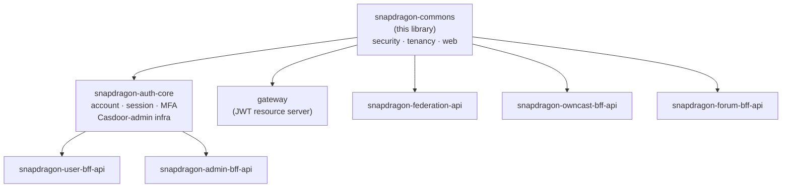

# snapdragon-commons

The shared, **canonical** Snapdragon security / tenancy / config / web building
blocks. The classes in this library were previously duplicated — with only package names
and access modifiers changed — into every reactive BFF (`snapdragon-federation-api`,
`snapdragon-admin-bff-api`, `snapdragon-user-bff-api`, `snapdragon-owncast-bff-api`,
…) and the gateway. This library is the single source of truth; the per-repo copies are
replaced by a compile dependency on it.

It sits at the bottom of the shared-artifact stack. `snapdragon-auth-core` — the
shared account / session / MFA / Casdoor-admin infrastructure consumed by
`snapdragon-user-bff-api` and `snapdragon-admin-bff-api` — depends on **this** library
for its security and tenancy primitives. Every reactive service also depends on it
directly for the security / tenancy / web classes described below — as does the
gateway's JWT resource server, which uses `CasdoorAuthorities` / `Roles` /
`DomainRegistry` from this library for JWT validation, role extraction, and domain
resolution (see the native-login sequence diagram under [Current State](#current-state)).



## Coordinates

```
groupId:    systems.snapdragon
artifactId: snapdragon-commons
version:    2.0.0
packaging:  jar
```

Child of `systems.snapdragon:snapdragon-parent:2.7.0` (the metapom), which pins the
ecosystem baseline: **Spring Boot 4.0.7 / Spring Cloud 2025.1.2** on **Java 25 LTS**
(eclipse-temurin:25), with Testcontainers 2.0.5.

## Contents

| Class | Package | Role |
|-------|---------|------|
| `Roles` | `systems.snapdragon.commons.security` | JWT role / domain / MFA-stamp extraction. |
| `RoleName` | `systems.snapdragon.commons.security` | closed enum of the four base Casdoor role tokens (`user`/`mod`/`admin`/`superadmin`); fail-closed `fromWire`/`require`/`isBaseRole` with the lowercase on-the-wire value preserved as a live contract. |
| `CasdoorAuthorities` | `systems.snapdragon.commons.security` | Casdoor JWT → Spring authorities converter (the RESERVED-PREFIX injection guard lives here). |
| `DomainRegistry` | `systems.snapdragon.commons.security` | issuer-URI → brand/domain map; single-issuer back-compat + multi-brand fail-closed; `knownDomains`/`isKnownDomain` validation. |
| `PrincipalDomain` | `systems.snapdragon.commons.security` | instance-based, SUPERADMIN-aware per-request tenant scope (was the federation/admin `DomainScope`). |
| `DomainScope` | `systems.snapdragon.commons.tenancy` | static SQL-predicate utility (`andPredicate`/`isUnscoped`) for per-domain repositories (was the user/owncast `DomainScope`). |
| `TenancyResourceServerConfig` | `systems.snapdragon.commons.config` | config-gated, backward-compatible multi-issuer (per-brand Casdoor) resource-server wiring. |
| `ApiException` | `systems.snapdragon.commons.web` | the BFF `{"error": msg}` exception with the full union of HTTP-status factories. |

## Preserved security behaviours

1. JWT `roles` claim → `ROLE_` authorities, via `Roles.fromJwt` and `CasdoorAuthorities`.
2. `isAdmin` claim (boolean or string, including the Casdoor legacy form) → `ROLE_ADMIN`.
3. `DOMAIN_<x>` authority is derived **only** from the cryptographically-validated JWT
   issuer URI — never from user-supplied claim values.
4. **RESERVED_PREFIXES guard** — any permission string beginning with `ROLE_`,
   `DOMAIN_`, or `MFA_SATISFIED` that arrives in a user-controlled claim is silently
   dropped, preventing authority injection, cross-tenant escalation, and MFA forgery.
5. **Fail-closed domain resolution** — an unknown issuer resolves to `null` (not a
   default domain). `domainOf(authorities)` also returns `null` when zero or more than
   one `DOMAIN_` authority is present, because multiple domain authorities are a sign of
   token manipulation.
6. SUPERADMIN principals are exempt from per-domain scoping. This is enforced uniformly
   via `Roles.isSuperadmin` and `PrincipalDomain`.
7. `MFA_SATISFIED` is derived only from a fresh `mfa_satisfied_at` stamp written by the
   BFF after a successful MFA challenge. Stamps set in the future, older than the
   acceptable window, or malformed are rejected. This authority ships disabled by
   default until MFA is enabled in the deployment.
8. Multi-issuer support (for per-brand Casdoor deployments) is opt-in and
   backward-compatible, controlled by `isMultiIssuer()` /
   `@ConditionalOnExpression`.

All eight are covered by the unit tests under `src/test/java`.

## What stays per-repo

`SecurityConfig` stays in each service: its `authorizeExchange` route matchers
(`/bff/admin/**`, `/bff/user/**`, `/bff/owncast/**`, `/api/federation/**`) and CSRF /
cookie handling differ between services and cannot be centralised. Each repo's
`SecurityConfig` wires the shared `CasdoorAuthorities` / `DomainRegistry` and,
optionally, `TenancyResourceServerConfig`, then declares its own route authorisation
rules. The per-repo security-slice test scaffold (`SecuritySliceSupport`) also stays
per-repo because it must construct the per-repo `SecurityConfig`.

## Using it

```xml
<dependency>
  <groupId>systems.snapdragon</groupId>
  <artifactId>snapdragon-commons</artifactId>
  <!-- version managed by snapdragon-parent -->
</dependency>
```

Then delete the repo-local copies of the classes above and update the import
statements. The package root changes from the repo-specific prefix to
`systems.snapdragon.commons.*`:

```
# Before (example from federation-api)
import systems.snapdragon.federation.security.Roles;
import systems.snapdragon.federation.security.DomainRegistry;

# After
import systems.snapdragon.commons.security.Roles;
import systems.snapdragon.commons.security.DomainRegistry;
```

**Method rename:** Two overloads of `Roles` that accepted `Set<String>` (raw authority
name strings rather than `GrantedAuthority` objects) were renamed to avoid an ambiguity
that the Java compiler cannot resolve at the call site when generics are erased:

| Old name (federation form) | New name |
|---|---|
| `Roles.isSuperadmin(Set<String>)` | `Roles.isSuperadminNames(Set<String>)` |
| `Roles.domainOf(Set<String>)` | `Roles.domainOfNames(Set<String>)` |

Calls that pass a `Collection<GrantedAuthority>` use the existing overloads unchanged.

## Shared test base (published test-jar)

Alongside the main jar, the `maven-jar-plugin` `test-jar` goal publishes
`systems.snapdragon.commons.testsupport.PostgresTestSupport`
(`src/test/java/systems/snapdragon/commons/testsupport/PostgresTestSupport.java`) as
`systems.snapdragon:snapdragon-commons:2.0.0:tests` (test scope). Consumers extend it
to get ONE shared Testcontainers-Postgres base for the whole org instead of
re-copying the container/Liquibase/R2DBC wiring per repo:

```xml
<dependency>
  <groupId>systems.snapdragon</groupId>
  <artifactId>snapdragon-commons</artifactId>
  <classifier>tests</classifier>
  <scope>test</scope>
  <!-- version managed by snapdragon-parent -->
</dependency>
```

```java
class MySliceTest extends PostgresTestSupport { /* ... */ }
```

Key properties: a single static Postgres container reused across the whole test JVM
(started once, not per-class), a fresh `cmtest_<n>` database created per test class so
Liquibase seeds never leak across classes, and a `jsonTypeOverride()` seam (defaults to
`"text"`) for repos whose changelogs reference `${json.type}` against a real `jsonb`
column.

## Build / publish

| Goal | Command |
|---|---|
| Compile and run unit tests | `./mvnw verify` |
| Install to local Maven cache (`~/.m2`) for offline sibling-repo use | `./mvnw install` |
| Publish to GitLab Maven Package Registry (CI only) | `./mvnw deploy -s settings.xml` |

`./mvnw verify` also publishes the **test-jar** described in [Shared test base
(published test-jar)](#shared-test-base-published-test-jar) above, alongside the main
jar.

CI publishes the jar on the default branch and on version tags. The deploy step
authenticates using the GitLab-injected `CI_JOB_TOKEN` — no secret is committed to the
repository. Snapdragon CI runs on GitLab; there are no GitHub Actions in this repo.

## Current State

- **At `2.0.0` on the unified ecosystem baseline** — Spring Boot 4.0.7 / Spring Cloud
  2025.1.2 on Java 25 LTS, child of `snapdragon-parent:2.7.0`. The artifact's own
  version was bumped from `1.0.0` to `2.0.0` as part of the org-wide Boot 4 migration
  (`snapdragon-federation-api` is the migrated exemplar); the parent metapom has since
  advanced independently through the org-wide dependency-upgrade campaign (Java 21→25
  LTS, Testcontainers 2.0.5) to `2.7.0`. These are two different version numbers
  (this artifact's own `2.0.0` vs. the inherited `snapdragon-parent:2.7.0`) and are not
  expected to track each other — see [Coordinates](#coordinates) and `pom.xml`.
- **Bottom of the shared-artifact stack.** `snapdragon-auth-core` (the shared
  account / session / MFA / Casdoor-admin infrastructure) depends on this library;
  `snapdragon-auth-core` is in turn consumed by `snapdragon-user-bff-api` and
  `snapdragon-admin-bff-api`. All reactive BFFs, and the gateway's resource-server
  config, depend on commons directly for the security / tenancy / config / web
  primitives above.
- **Auth-model alignment.** The current native-login design keeps the Casdoor JWT
  entirely server-side and Casdoor internal-only — it never redirects the browser.
  `login-ui` renders a first-party login form that POSTs credentials straight to
  `/bff/login` (via the gateway); `user-bff` runs the entire OIDC/PKCE handshake with
  Casdoor itself (generating the PKCE verifier/challenge and state, hitting Casdoor's
  internal `/api/login`, and exchanging the code for a JWT), then holds that JWT in
  server-side session storage. The browser never sees a Casdoor URL, authorization code,
  or JWT — it receives only an opaque `bff_`-prefixed session cookie. At the gateway, a
  pre-security exchange filter resolves the `bff_` cookie to the internal custody JWT, so
  JWT validation, role extraction, and domain resolution — all implemented in this
  library — run without modification.

  ```mermaid
  sequenceDiagram
      participant Browser
      participant login-ui
      participant gateway
      participant user-bff
      participant Casdoor

      Browser->>login-ui: fill native login form
      login-ui->>gateway: POST /bff/login (credentials)
      gateway->>user-bff: route to user-bff (permitAll)
      user-bff->>Casdoor: internal /api/login + PKCE code exchange
      Casdoor-->>user-bff: Casdoor JWT (held server-side)
      user-bff-->>Browser: Set-Cookie: bff_<opaque>
      Browser->>gateway: API request + bff_ cookie
      gateway->>user-bff: resolve bff_ → JWT
      user-bff-->>gateway: internal custody JWT
      gateway->>gateway: CasdoorAuthorities / Roles / DomainRegistry
      gateway-->>Browser: authorised response
  ```

  Login / session / account logic is being relocated from `admin-bff` to `user-bff`,
  with the shared core extracted to `snapdragon-auth-core`. This library is unchanged
  by that move — it remains the JWT→authorities and tenancy substrate underneath both.
- **`MFA_SATISFIED` is load-bearing.** Behaviour 7 — deriving `MFA_SATISFIED` from a
  fresh `mfa_satisfied_at` stamp written by the BFF, with the reserved-prefix guard
  blocking forgery — is how BFF-driven MFA challenges are enforced even when the
  gateway sees only an opaque `bff_` session. The authority ships disabled by default
  until MFA is enabled in the deployment.
- All eight preserved security behaviours remain covered by unit tests; the GitLab CI
  publish path to the Maven Package Registry is in place.

## Roadmap

This library underpins several in-flight and planned platform initiatives. New shared
primitives land here as they are generalised across services:

- **SSO end-to-end live + e2e** — the opaque `bff_` ↔ custody-JWT bridge has been
  verified through the gateway resource server against the `CasdoorAuthorities` /
  `DomainRegistry` path. Full end-to-end test coverage is in progress.
- **MFA** (WebAuthn + TOTP + recovery, per-role defaults, step-up) — builds directly
  on the `MFA_SATISFIED` stamp derivation (behaviour 7) and the reserved-prefix guard
  already present in this library.
- **Multi-tenancy / multi-brand superadmin** — per-domain CA with per-brand
  gateway / BFF / UI instances. This exercises the opt-in multi-issuer path
  (`TenancyResourceServerConfig`) and the fail-closed domain resolution already
  implemented here.
- **Downstream platform work** that consumes these primitives without requiring changes
  to them: data-driven gateway route authorisation (`gateway_route_access`), encrypted
  versioned backups, egress VPN drop-in, per-node attached storage, desktop app
  governance, workload console, device-license registry, games app-store, audio/video
  relay via coturn/TURN, and OWASP pen-test + nuclei integration in CI.
